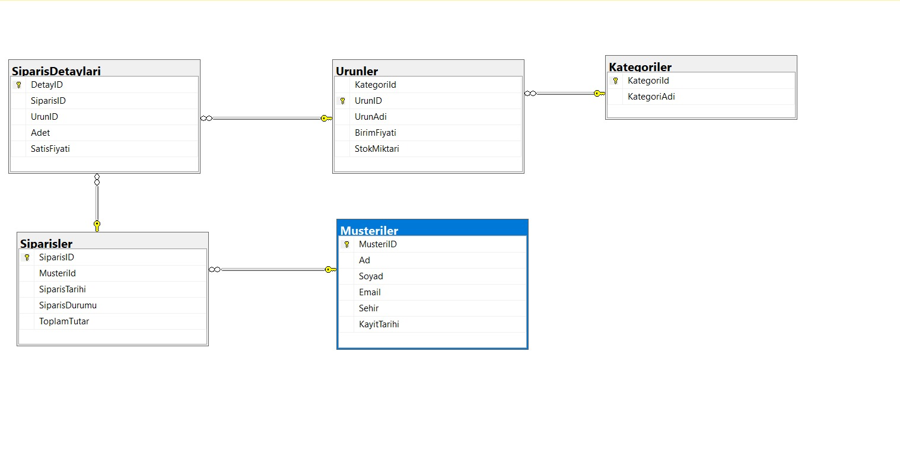

# E-Ticaret Sipariş ve Stok Yönetim Sistemi (MS SQL Server)

Bu proje, temel bir e-ticaret operasyonundaki müşteri, kategori, ürün ve sipariş süreçlerini ilişkisel veritabanı mimarisiyle yönetmek, iş kurallarını otomatize etmek ve satış analizleri üretmek amacıyla **T-SQL** kullanılarak geliştirilmiştir.

## Veritabanı Mimarisi
Sistem 5 ilişkisel tablodan oluşmaktadır:
- **Musteriler:** Müşteri iletişim ve şehir bilgileri (`UNIQUE` e-posta kısıtı ile)
- **Kategoriler & Urunler:** Ürün kataloğu, fiyatlandırma ve stok miktarı takibi
- **Siparisler & SiparisDetaylari:** Çoklu ürün sepet yapısı ve geçmiş fiyat koruması

## Dosya Yapısı ve İçerik
1. **`01_Tablolar.sql`**: Veritabanı ve ilişkisel tabloların (`PK`, `FK`, `IDENTITY`, `DEFAULT`) kurulumu.
2. **`02_Veri_Ekleme.sql`**: Test senaryoları için ilişkisel bütünlüğe uygun örnek veri girişleri.
3. **`03_Analiz_Sorgulari.sql`**: `INNER JOIN`, `LEFT JOIN` ve `GROUP BY` kullanılarak hazırlanan kategori cirosu, VIP müşteri ve kritik stok raporları.
4. **`04_Otomasyon_ve_View.sql`**: 
   - **`vw_YoneticiSatisOzeti` (View):** Karmaşık tablo birleştirmelerini tek sorguda sunan sanal rapor tablosu.
   - **`trg_SiparisSonrasiStokDus` (Trigger):** Yeni sipariş girildiğinde ilgili ürünün stok miktarını otomatik azaltan tetikleyici.

## Kullanılan Teknolojiler
* **DBMS:** Microsoft SQL Server
* **Araç:** SQL Server Management Studio (SSMS)
* **Dil:** T-SQL
